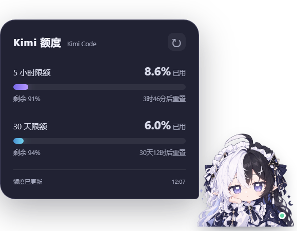

# Kimi 娘额度挂件

一个使用 Kimi Code 当前登录状态的只读额度插件与桌面看板娘。上方显示 5 小时窗口已用量，下方显示 30 天月度总额度已用量；进度条越满，使用越多。



> 预览图使用真实额度接口渲染，数值已随账号变化，仅示意界面。

## 已实现

- 真实额度查询，60 秒自动刷新与手动刷新
- 5 小时、30 天已用百分比及各自重置倒计时
- 单击角色展开/收起，默认 10 秒自动收起，也可改为 5 秒、30 秒或关闭
- 只在 Kimi Code 或 Kimi 客户端宿主窗口内活动，不全局置顶、不越出宿主边框
- 按压回弹，拖动后吸附宿主左右边缘并切换角色朝向，宿主移动/缩放时跟随
- 角色与额度面板分别调整 80%–150% 大小，设置立即保存；宿主空间不足时自动等比适配
- 按压/松开音效、Kimi Code / Kimi Work 回复及后台任务完成音效，独立开关、音量与试听
- 查询失败时保留上次成功快照，并明确标记错误
- 演示模式使用明确标注的模拟数据，不冒充真实额度
- Kimi 插件清单、MCP 查询工具、会话启动及任务完成 hooks

## 桌面运行

需要 Windows、Node.js 20 或更新版本，以及已登录的 Kimi Code。

```sh
npm ci
npm start
```

界面演示（不读取账号，不发起额度请求）：

```sh
npm run demo
```

操作：

- 单击角色：展开或收起额度气泡；展开一段时间后会自动收起，面板内操作重新计时。
- 拖动角色或透明区域：在宿主窗口内移动，松开后吸附到宿主较近的一侧。
- 右键 → `挂件设置`：选择自动 / Kimi Code / Kimi 客户端宿主，分别调整角色和面板大小、自动收起时间、音效开关及音量，并可试听。
- 右键菜单还可刷新、切换宿主边缘吸附/演示模式和退出。
- `Esc`：收起气泡；`F5`：刷新。

角色图片位于 `assets/kimi-niang.png`。文件缺失时使用临时占位角色。设置窗口属于桌面挂件；Kimi Code 插件管理器目前不提供插件自定义原生设置页。

## 宿主窗口行为

挂件是宿主的 Windows 附属窗口，不向 Kimi 进程注入代码，也不作为全局置顶图层。自动模式优先选择前台的 Kimi Code / Kimi 窗口；当前宿主最小化时转去另一个未最小化的宿主，两个都最小化才隐藏，恢复任意一个后会自动上线。其它应用前台时，挂件仍只在宿主区域内，并遵守 Windows 的普通窗口层级。

窗口位置按宿主相对偏移保存，因此重启或宿主移动后仍在原位置附近。宿主被缩小到容纳不下挂件时，角色与面板会临时等比缩小；恢复宿主大小后回到用户设置的比例。边界钳制包含透明窗口取整的安全内边距。该功能依赖 Windows 窗口接口，不支持 macOS / Linux。Kimi Work / Kimi Chat 若在 `Kimi` 客户端窗口中运行，可以作为视觉宿主，但这不代表插件获得了其任务数据。

## 作为 Kimi Code 插件安装

在仓库根目录运行一次 `npm ci`，然后在 Kimi Code 中执行：

```text
/plugins install C:\Kimi
/reload
```

发布到 GitHub 后，也可以直接安装仓库 URL：

```text
/plugins install https://github.com/wangtheme-coder/kimi-niang-quota-widget
```

插件安装后会被复制到 `$KIMI_CODE_HOME/plugins/managed/kimi-niang-quota/`。如果通过插件管理器安装，需要在上述**托管目录**运行一次 `npm ci`，桌面组件才能自动启动；MCP 查询本身不依赖 Electron。

插件提供：

- `get_quota`：只读查询当前账号，不创建聊天或模型请求。
- `open_widget`：启动桌面挂件。
- `/kimi-niang-quota:quota`：通过 Agent 查询并解释额度。
- `SessionStart` hook：依赖已安装时启动桌面挂件。
- `Stop` hook：一轮回复结束时播放完成音。
- `Notification` + `task.completed` hook：后台任务完成时播放完成音。

## 作为 Kimi Work 个人插件导入

Kimi 官方说明 Kimi Work 与 Kimi Code 支持完整 Hooks。发布 GitHub 后，在最新版 Kimi Work 中唤起 **Plugin Builder**，把仓库链接交给它导入；然后进入「插件」→「个人」安装，并在新会话中测试。桌面组件需要在实际插件源目录运行一次 `npm install`，否则 `SessionStart` 会安静跳过启动。

Work 的实际 Plugin Builder 转换和安装需要在客户端中确认；源码包内的模拟 Work hook 已验证能通过同一通知桥播放完成音，但不代替客户端端到端验收。

## 音效与客户端边界

音效由 Web Audio 实时合成，不使用 DSH 的音频素材。Hooks 通过 Windows 本机命名管道通知已运行的挂件；挂件未运行时安静退出，不会仅为播放声音而弹出窗口。短时间内的重复完成事件会去重。

完成事件接入 **Kimi Code 与 Kimi Work** 的官方 Hooks。Kimi Chat 尚无已验证的任务完成 Hook 或进度 API，因此暂未接入任务音效和进度查询；插件不会读取客户端私有聊天数据。Chat 与 Work 都能使用 `Kimi` 窗口作为视觉宿主，但视觉宿主与任务数据接入是两件独立的事。

## 数据与隐私

额度来自 `https://api.kimi.com/coding/v1/usages`。30 天栏采用 `usages.limit_month_total`，不是 `limit_month_code`。令牌只在本机内存中读取，并仅用于该 Kimi 请求；不会写入设置、缓存、日志或发送到第三方。

设置和不含凭据的额度快照保存在 Electron 的用户数据目录。完成 hook 只向本机挂件传递事件类型、来源和会话标题，不读取或传输令牌及聊天内容。宿主跟踪只使用进程名、窗口句柄、矩形和最小化状态，不读取窗口标题或会话内容。该 usages 接口没有第三方稳定性承诺，未来字段变化可能需要更新解析器；查询失败不会用本地 Token 统计或随机值替代真实额度。

## 验证状态

```sh
npm ci   # 按 package-lock.json 安装
npm run check   # 全部 JS 语法检查
```

2026-10-27 在 Windows 11 + Node.js 22 + Electron 39.8.10 实机验证通过：

- `npm ci`、`npm run check`、`npm start`（演示模式与真实账号）均可启动，渲染进程无控制台报错。
- 真实接口返回 `limit_5h` / `limit_month_total` / `limit_month_code` 三个键，30 天栏取自 `limit_month_total`（实测 5.96%），不是 `limit_month_code`（实测 5.93%）。
- 5 小时与 30 天两条进度条、已用百分比、剩余量与重置倒计时显示正常，未出现裁切或重叠。
- 挂件是 Kimi Code 主窗口的 **附属窗口**（owner 为宿主 HWND），未设置 `WS_EX_TOPMOST`，位置被钳制在宿主矩形内。
- 本机命名管道 `\\.\pipe\kimi-niang-quota` 可连接，`scripts/notify-widget.cjs` 发送完成事件后安静退出（0）。
- 自动模式下的前台切换、最小化切换与隐藏依赖真实鼠标操作，仅做了跟踪器输出层面的检查。

**未验证**：Kimi Work 的 Plugin Builder 导入转换与「插件 → 个人」安装流程；Kimi Chat 的任务事件与进度接口（未接入，也没有对外宣称支持）。这两项需要在对应客户端里人工验收。

## 许可证与素材

- 代码：MIT，见 [LICENSE](LICENSE)。
- `assets/kimi-niang.png`：角色美术素材权利归作者，**不随 MIT 授权**，仅允许在本项目内原样使用，见 [NOTICE.md](NOTICE.md)。
- `package-lock.json` 的 `resolved` 指向 npmmirror 镜像；使用其它镜像时可删除 lockfile 后重新 `npm install` 生成，或设置 `npm config set registry`。

灵感参考：[DSH 小鲸鱼](https://github.com/MeteorNOX/DeepSeek-Balance-Whale-Widget) 与 [GPT 娘](https://github.com/T7moris/GPT-Niang)。代码独立实现，角色图片权利归其作者。

